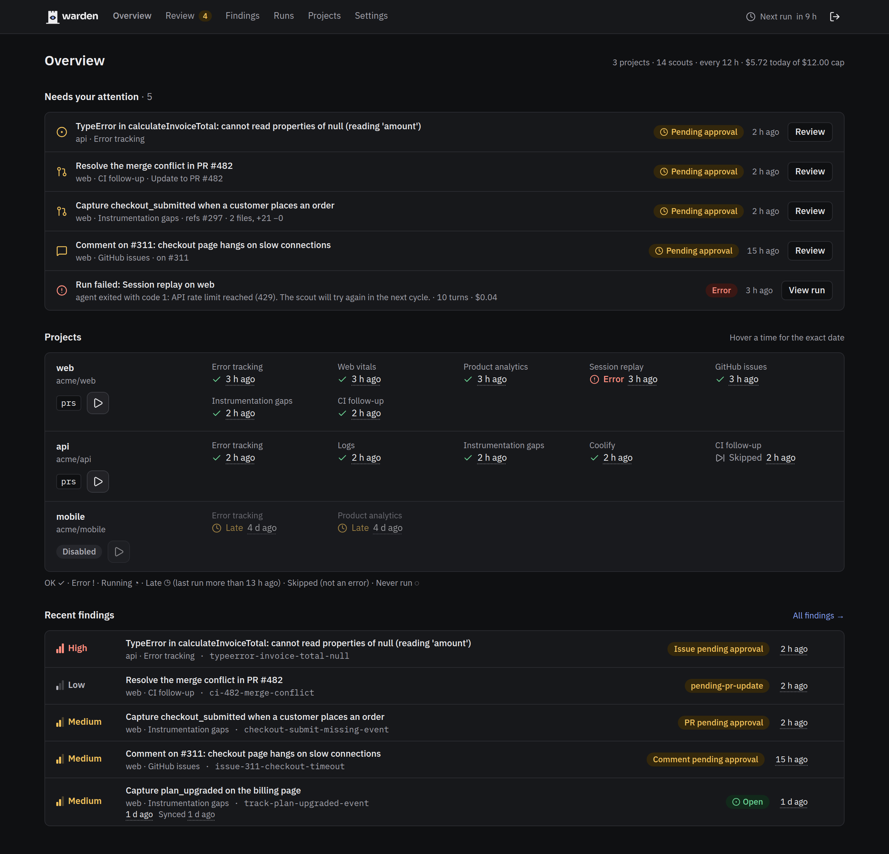
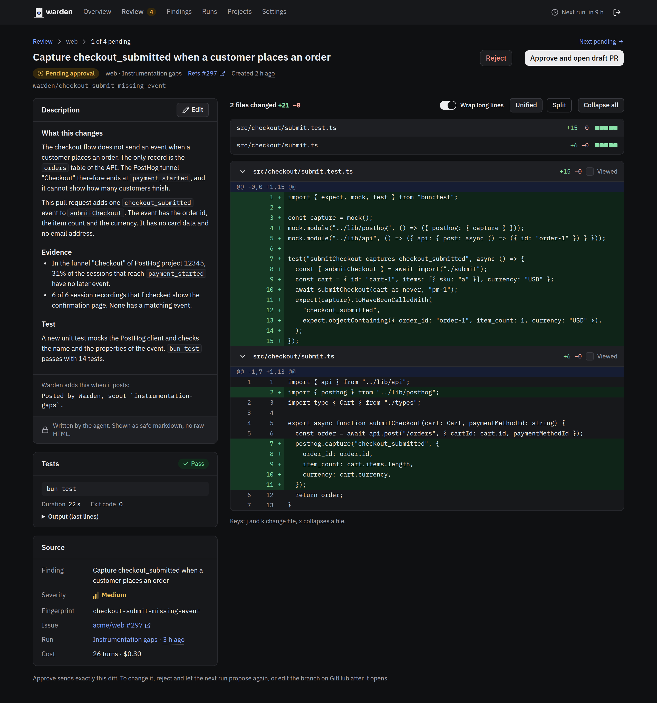
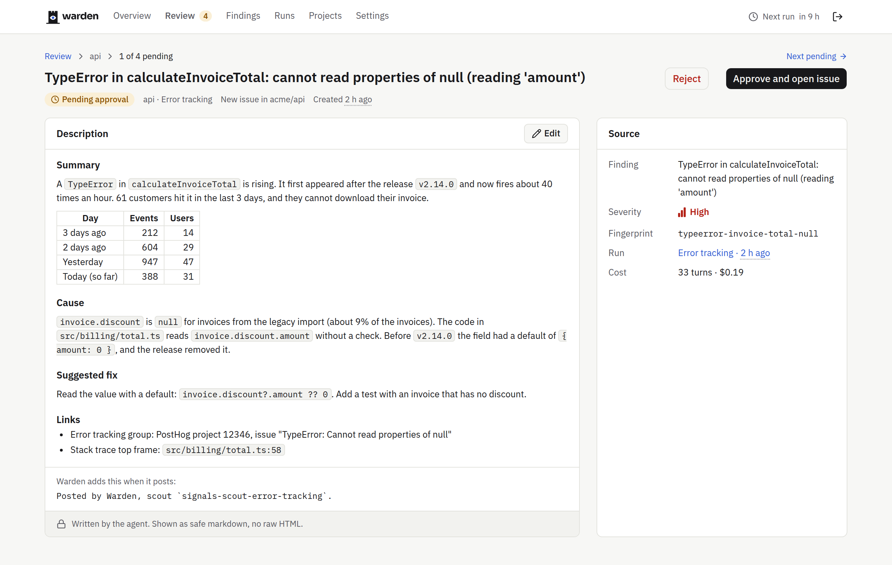
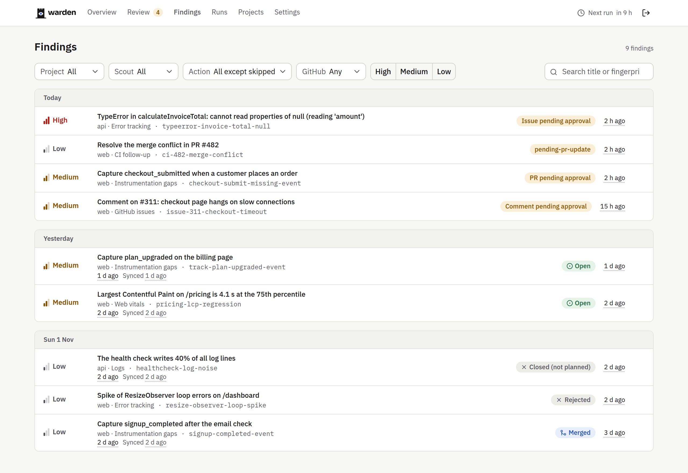
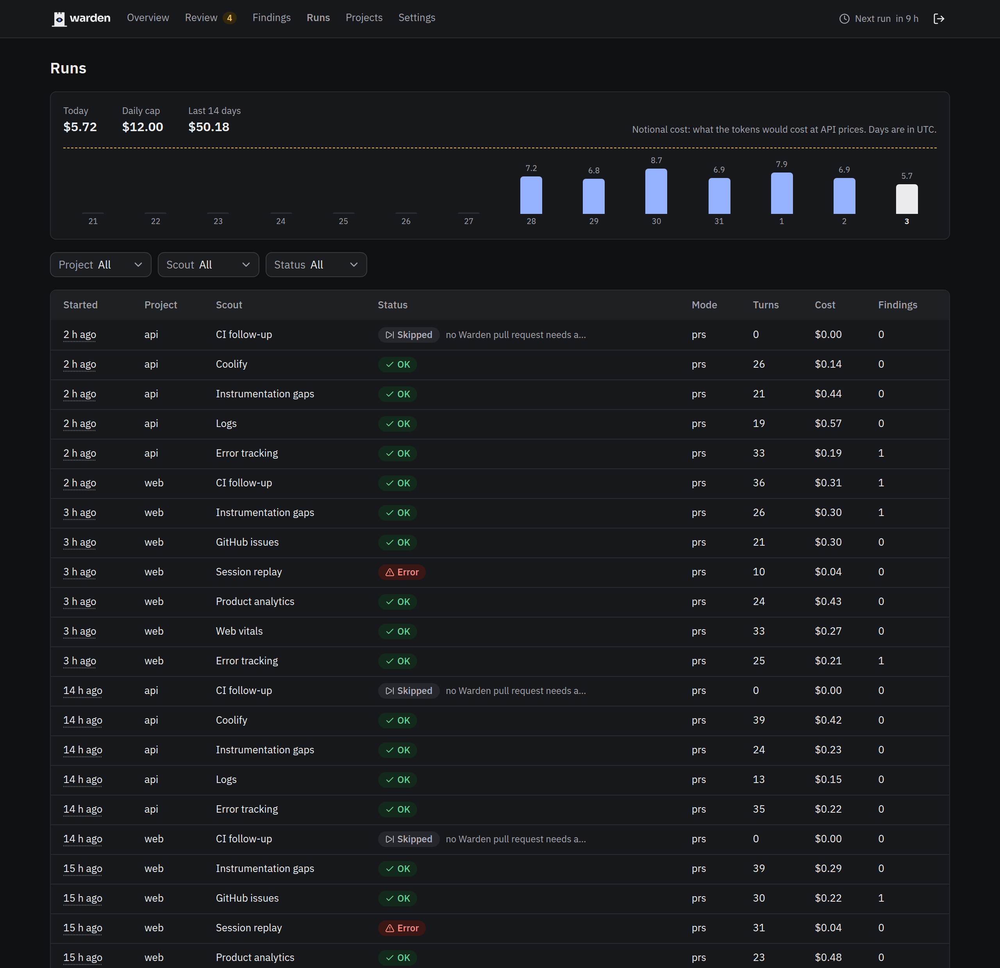
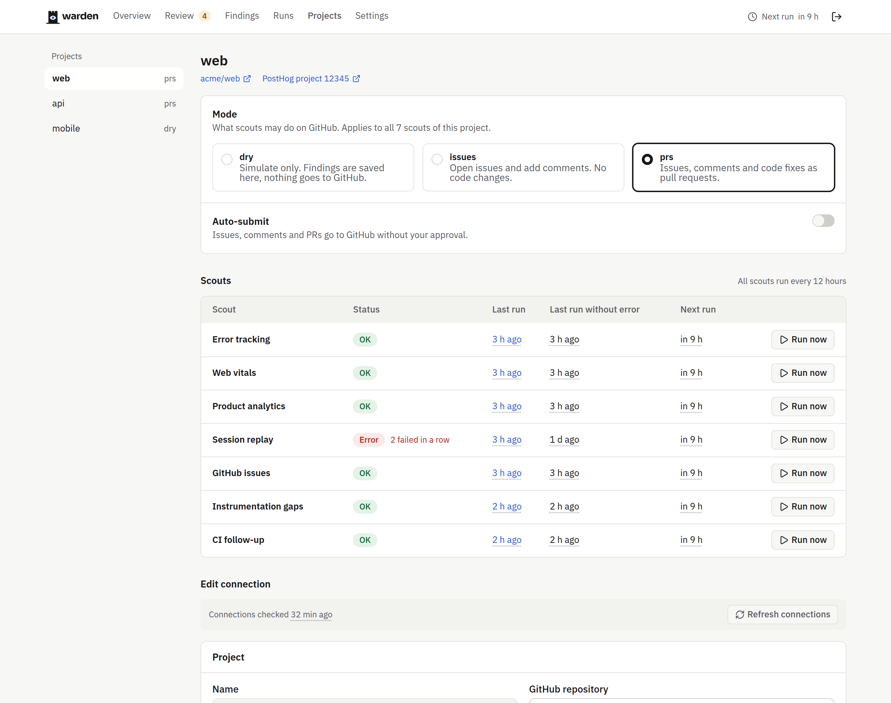
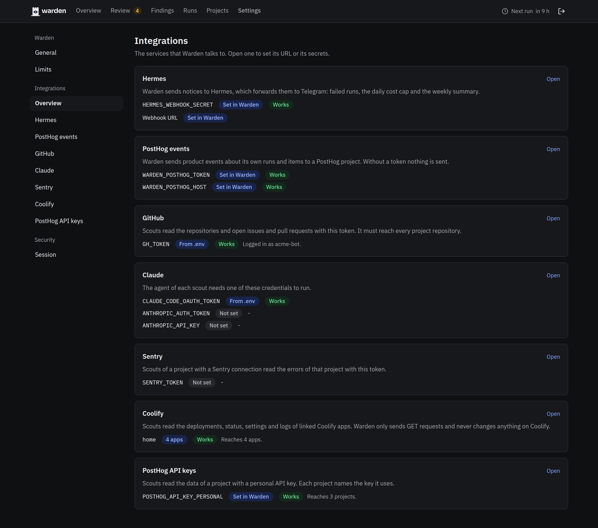
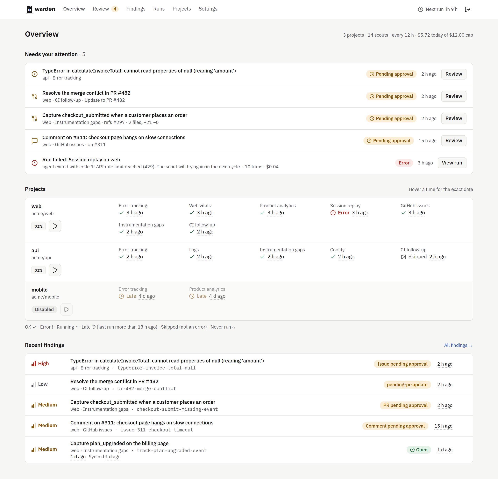
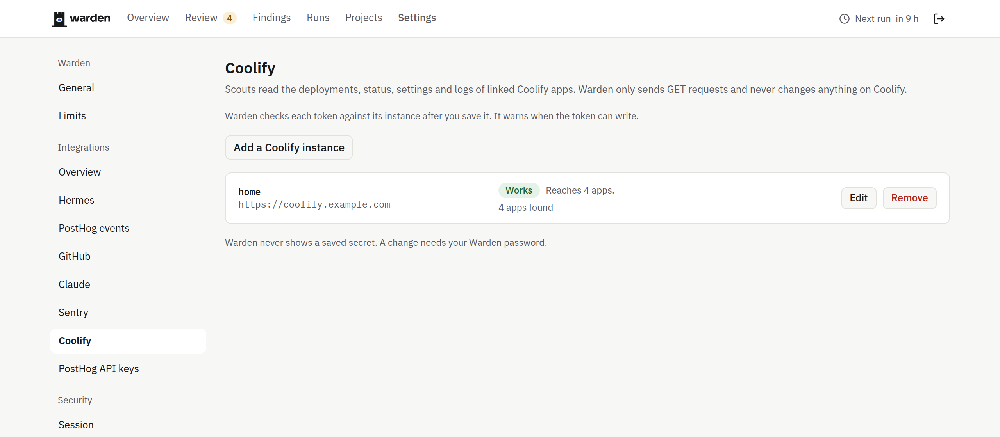

<p align="center">
  <picture>
    <source media="(prefers-color-scheme: dark)" srcset="docs/assets/warden-lockup-dark.svg">
    
  </picture>
</p>

Warden runs headless Claude Code on a schedule.
Each run uses one scout skill on one project.
The agent reads the PostHog data of the project (read-only) and the repository checkout.
The agent returns findings as JSON.
The scripts, not the agent, open the GitHub issues and the draft pull requests.

[](https://github.com/omznc/warden/releases)



## Screenshots

| Review (PR) | Review (issue) | Findings |
| :---: | :---: | :---: |
| [](docs/screenshots/review-pr-dark.png) | [](docs/screenshots/review-issue-light.png) | [](docs/screenshots/findings-light.png) |
| **Runs** | **Project** | **Integrations** |
| [](docs/screenshots/runs-dark.png) | [](docs/screenshots/project-light.png) | [](docs/screenshots/integrations-dark.png) |
| **Overview (light)** | **Coolify** | |
| [](docs/screenshots/overview-light.png) | [](docs/screenshots/coolify-light.png) | |

The screenshots use invented data. The script `scripts/demo-state.sh` builds the same demo state.
More screenshots are in [`docs/screenshots`](docs/screenshots).

## Approval gate

Nothing leaves warden without approval, unless a project has "Auto-submit" on.
The scripts save each issue, comment and pull request as a pending item.
A person reads the item on the page "Review" of the UI, and approves or rejects it.
The text that the person approves is the text that GitHub gets.
The default mode is `dry`: no GitHub writes.

## Requirements

- A container engine with compose (`podman compose` or `docker compose`).
- A Claude Code token (`claude setup-token`).
- A GitHub token that can read and write issues and pull requests on the project repositories.
- A PostHog personal API key with the "MCP Server" preset. Use one key for each PostHog account or project.
- Optional: a Hermes webhook (notices), Sentry, Coolify (see `docs/domains/coolify.md`), and a PostHog project token for events about the runs.

## Quick start

1. Copy `.env.example` to `.env`. Fill in the tokens and set `WARDEN_PASSWORD`.
2. Optional: copy `projects.example.json` to `projects.json` and edit it. The runner uses it as the first list of projects. You can also add projects in the UI.
3. Start the stack:

```sh
podman compose up -d --build
```

4. Open `http://127.0.0.1:8650` and log in. The user name is `WARDEN_USER` (default `admin`).
5. Run one scout one time:

```sh
podman compose run --rm -e ONCE=1 runner bin/run-all.sh web signals-scout-error-tracking
```

Set `MODE` in `.env` and move up one step at a time: `dry`, then `issues`, then `prs`.
The loop waits `INTERVAL_HOURS` (default 12) between passes.

## Deploy behind a proxy

Copy `compose.override.example.yaml` to `compose.override.yaml`. Compose reads it with `compose.yaml`.
The file joins the UI to an external proxy network, and the runner to an optional external Hermes network.
Set `PROXY_NETWORK` and `HERMES_NETWORK` in `.env` to change the network names.
Set `WARDEN_URL` (or the setting "Warden URL" in the UI) to get a review link in each notice.
Without it, notices have no link.

## Security model

- The agent runs as a separate user (`agent`, uid 1001). The runner starts it with `sudo` and `env -i`, so it gets no environment from the runner.
- Only the runner has the GitHub token, the PostHog keys and the webhook secret. The agent gets its model credential only.
- The runner reads only trusted inputs: the allowlisted secrets in the inbox, and its own files in the state.
- The tester runs the tests of a pull request with no network, no secrets and no state.
- The runner scans every item for secrets before it saves the item and again before it writes to GitHub. A hit blocks the write.
- Text from issues, comments and code is untrusted data for the agent.

Details are in `docs/domains/` and in the table "Where the rest lives" of the root `CLAUDE.md`.

## Scouts

The skills are in `skills/`:

- `signals-scout-error-tracking`, `signals-scout-web-vitals`, `signals-scout-product-analytics`, `signals-scout-session-replay`, `signals-scout-logs`, `signals-scout-observability-gaps`: copies of the PostHog scouts.
- `github-issues`: triage of the open issues that trusted people filed.
- `instrumentation-gaps`: finds code that has no tracking.
- `warden-ci`: follows up the failed checks of the pull requests of warden.
- `coolify`: reads the logs of Coolify applications.

## Licence

Warden uses the MIT licence. See `LICENSE`.
The scout skills `skills/signals-scout-*` are copies from PostHog. They use the MIT licence of PostHog. See `skills/LICENSE-posthog`.
The text in `prompts/harness.md` maps the PostHog-internal tools of the skills to local files.

## Development

Run `bun install`, `bun run typecheck`, `bun test src` and `bun run build` in `app/`.
Run the shell tests inside the image, because the image has an older `jq` than the host:

```sh
podman run --rm --security-opt label=disable -v "$PWD":/src -w /src warden bash test/gate.sh
```

`test/agent-perm.sh` needs root (`-u 0`).
